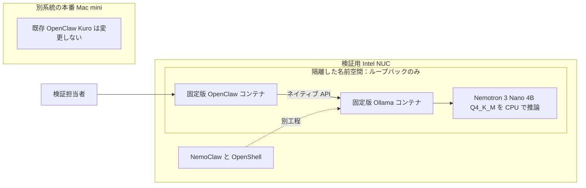

# Nemotron OpenClaw Lab

[English](README.md) | 日本語

CPUのみのIntel NUCで、NVIDIA Nemotronを使う2台目のOpenClawは動くか。本番のMac miniには手を加えず、外部APIにプロンプトを送らない構成で試します。まずはNemotron 3 Nano 4Bに、OpenClaw経由で短いテキストを1件返させます。

> **ステータス：CPUで組み込みエージェントの実機検証に合格。** 追加試験では OpenClaw `agent --local` と Nemotron が指定どおりの短文を3回返しました（1回約95〜107秒）。モデル常駐でロード時間は短くなりましたが、この試験では応答全体は速くなりませんでした。初回の Gateway 経由で応答が一致しなかった原因は未解明です。

## 構成図

OpenClawはエージェントの実行基盤、Nemotronはモデルです。NVIDIA OpenShellはサンドボックスのポリシーを適用し、NVIDIA NemoClawはOpenShell上にOpenClawなどをセットアップするリファレンス構成です。OllamaでNemotronを動かすだけでは、OpenShellやNemoClawは導入されません。

| 段階 | 確認すること | 状態 |
| --- | --- | --- |
| 0. 実機の事前確認 | CPU・RAM・ストレージを確認 | 完了 |
| 1. ローカル推論 | Ollamaで短い応答を取得し、CPU実行とモデルの使用メモリを確認 | 1回合格 |
| 2. 2台目のOpenClaw | 独立した検証用の設定・状態で、ループバック経由のエージェントの一往復を合成テキストで確認 | 組み込みエージェントは合格。初回の Gateway 応答不一致は未解明 |
| 3. NVIDIAのサンドボックス | ローカル推論先と構造化ツール呼び出しを検証し、合成データで隔離を確認 | 任意・未検証 |

イメージとモデルの事前取得後、使い捨ての2コンテナは隔離した名前空間のループバックだけを共有します。ポート公開も、ホストパスやコンテナエンジンのソケットのマウントも行いません。本番機・その資格情報・既存連携は対象外です。クラウド推論・個人データ・メッセージ連携・外部公開ポート・本番デプロイ・自動ジョブは使いません。短文が返っても、サンドボックスの隔離や本番運用に適していることの証明にはなりません。

- [NUC検証手順](docs/nuc-poc.ja.md) | [English](docs/nuc-poc.md)
- [未ロード時と常駐時のCPU実測](docs/nuc-warm-results.ja.md) | [English](docs/nuc-warm-results.md)
- [初回実機試験](docs/first-trial.ja.md) | [English](docs/first-trial.md)
- [アーカイブと変更の経緯](archive/README.md) | [旧プロジェクト](archive/openshell-claude-reviewer/README.ja.md)
- [リポジトリのライセンス](LICENSE)。モデルの重みは同梱しておらず、[NVIDIAの個別ライセンス](https://huggingface.co/nvidia/NVIDIA-Nemotron-3-Nano-4B-GGUF)が適用されます。

個人の検証プロジェクトであり、NVIDIAまたはOpenClawの公式配布物ではありません。
