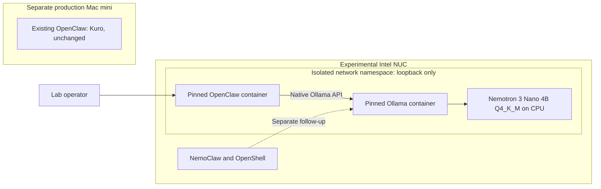

# Nemotron OpenClaw Lab

English | [日本語](README.ja.md)

Can a CPU-only Intel NUC run a second OpenClaw instance with NVIDIA Nemotron without touching the production Mac mini or sending prompts to a cloud API? Start with one local text request through OpenClaw and Nemotron 3 Nano 4B.

> **Status: hardware preflight complete.** The target NUC CPU/RAM/storage class was checked. Inference metrics, a full agent turn, and NVIDIA sandbox isolation are not yet verified.

## Target architecture

OpenClaw is the agent runtime. Nemotron is the model. NVIDIA OpenShell enforces sandbox policy; NVIDIA NemoClaw is a reference stack that can set up OpenClaw in OpenShell. Loading Nemotron in Ollama does not install either NVIDIA runtime component.

| Stage | Evidence required | Status |
| --- | --- | --- |
| 0. Hardware preflight | CPU, RAM and storage class checked | Complete |
| 1. Local inference | Bounded response from Ollama; measured memory and latency | Planned |
| 2. Second OpenClaw | Separate lab state; one full text-only agent turn through the loopback provider | Planned |
| 3. NVIDIA sandbox | Verified local provider, structured tool calls, and isolation against synthetic fixtures | Optional; not validated |

After staging the pinned images and model, the two disposable containers share only an isolated loopback namespace. No published ports, host paths, or container engine socket. The production machine, credentials, and integrations are out of scope. No hosted inference, personal data, messaging, public listener, production deployment, or autonomous jobs are needed. A text smoke test does not prove sandbox isolation or production readiness.

- [NUC validation guide](docs/nuc-poc.md) | [日本語](docs/nuc-poc.ja.md)
- [Archive and project history](archive/README.md) | [Previous project](archive/openshell-claude-reviewer/README.md)
- [Repository license](LICENSE). Model weights are not included and have [separate NVIDIA license terms](https://huggingface.co/nvidia/NVIDIA-Nemotron-3-Nano-4B-GGUF).

This is an independent lab, not an NVIDIA or OpenClaw release.
